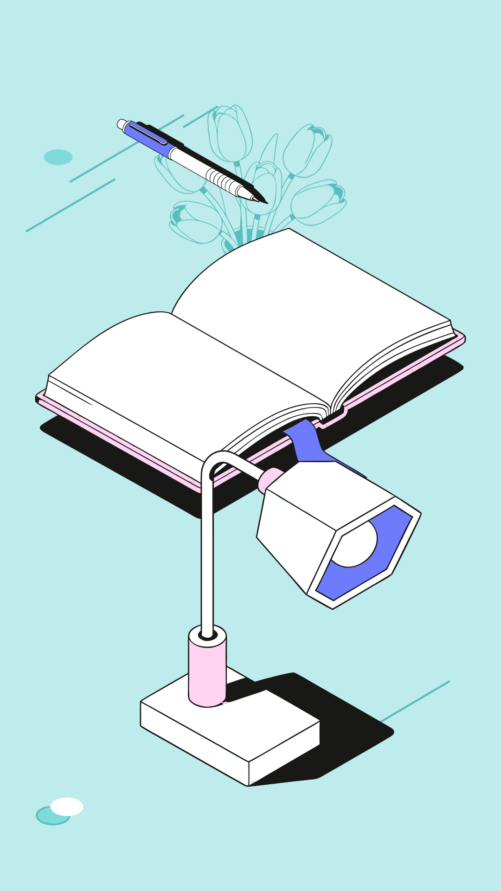

# Сборщик иллюстраций из библиотеки компонентов

Тестовое задание «Студии Очень» (Junior AI Developer).

Веб-сервис собирает векторные композиции из готовых объектов библиотеки. Новых объектов он не создаёт: итог — копии исходных SVG из Figma, расставленные и перекрашенные в рамках цветовой схемы.

- **Сервис:** https://composer-nu-seven.vercel.app
- **Репозиторий:** https://github.com/cartem2005-max/composer
- **Демо (1–2 мин):** _ссылка_
- **Примеры:** [`examples/`](examples/) — собраны тем же кодом: две метафоры подобрал ИИ, третья — список компонентов.

| «Как накопить на отпуск и не залезть в долги» → ИИ: кошелёк, монета · 1200×630, «Под заголовок» |
|---|
|  |

| «Подкаст о личных финансах» → ИИ: наушники, монета · квадрат, «Со смещением» | «лампа, книга, ручка, фоновые тюльпаны» · вертикаль, схема 3, размер S |
|---|---|
|  |  |

## Что умеет

**Сценарий 1 — метафора или заголовок.** «Как накопить на отпуск» → ИИ (Claude Haiku) выбирает подходящие объекты и их роли (главный / фоновый), код раскладывает их в выбранном формате. Если ИИ недоступен, работает запасной словарь ключевых слов, и сервис прямо пишет, что сработал словарь.

**Сценарий 2 — названия компонентов.** «книга, лампа и ручка», «фоновые тюльпаны», «нашуники» (с опечаткой), «книгу и ручку убери, оставь лампу», «без лампы: книга и ручка», 📚 + 💡 → нужные объекты. ИИ здесь не нужен: разбор делает код. Чего нет в библиотеке, сервис называет: «Не нашлось в библиотеке: ракета».

**Сборка:**
- добавить из библиотеки (клик — главный, Shift+клик — фоновый);
- перетащить, повернуть (ползунок или R), дублировать (Ctrl+D), удалить (Delete);
- порядок слоёв (`[` / `]`, «Наверх» / «Вниз»), отмена и возврат (Ctrl+Z / Ctrl+Shift+Z);
- для объекта: главный ↔ фоновый, другие цвета в рамках схемы;
- для композиции: размер L или S, общий масштаб, схема, цвет фона, декор фона из макета (овал и линии).

**Форматы и раскладки:** 1200×630, квадрат 1080, вертикаль 1080×1920 × «Собранно», «Со смещением» (крупно, с обрезкой краем), «Под заголовок» (место под текст слева или сверху). **«Другой вариант»** — та же подборка, другая расстановка: другой ведущий объект, зеркало, нахлёст. Работает без ИИ.

**Палитра:** 3 схемы из макета плюс своя — 6 или 8 HEX текстом либо JSON-файл. Перекрашивается вся композиция сразу. Цвет фона — один из трёх оттенков фона или чёрный, как в задании («цвета фона: 3 оттенка + чёрный»); цвета объектов в фон не попадают. Декор фона берёт цвета из фрейма «Фон» макета как есть (в его овале есть белый блик).

**Результат:**
- **«Копировать для Figma»** — SVG в буфер обмена, в Figma вставляется через Ctrl+V как векторы со слоями;
- «Скачать SVG» — файл с понятными слоями (`book-main-1`, `tulips-bg-1`, `decor`), без растров; файл совпадает с холстом — его рисует один и тот же код;
- «Все форматы (zip)» — та же подборка сразу в трёх форматах;
- «Поделиться» — ссылка, по которой коллега откроет ровно эту композицию (данные только в ссылке, без сервера);
- PNG-превью.

## Архитектура

```
figma-svg/size-L.svg, size-S.svg      ← выгрузка фреймов «Размер L» и «Размер S» из Figma
        │  scripts/build-library.mjs (при каждой сборке)
        ▼
src/library.generated.json            ← 10 объектов × L/S × главный/фоновый + декор фона, цвета заменены ролями
        │
        ├── src/render.ts             ← подстановка цветов схемы, transform, итоговый SVG
        ├── src/layout.ts             ← автораскладка под формат и её варианты
        ├── src/match/                ← подбор: ИИ (через api/pick.ts), отрицания, словарь, разбор списков
        ├── src/share.ts              ← ссылка «Поделиться» и проверка внешних данных
        └── src/main.ts               ← интерфейс редактора
```

### Хранение SVG-элементов

Figma отдаёт фрейм плоским списком из ~1500 фигур без групп и имён. Скрипт `build-library.mjs`:

1. Считает рамку каждой фигуры и склеивает в объект фигуры, которые идут подряд и лежат рядом. В Figma элементы одного объекта идут подряд, а рамки разных объектов в L иногда пересекаются, поэтому склейка идёт по порядку, а не по пересечению.
2. Делит объекты на главные и фоновые по заголовкам фрейма. Имена даёт по положению на листе, L сопоставляет с S по размеру (L ровно в 2 раза крупнее).
3. Заменяет каждый цвет на роль: `#F9ECB0` → `{obj1}`, `#7864D7` → `{bg3}` и т. д. Если встретился цвет не из схемы, сборка падает с ошибкой.
4. Проверяет, что в фоновых вариантах нет цветов объектов.
5. Из фрейма «Фон» берёт декор (овал и линии) и запоминает его положение в долях кадра.

Геометрия (`d` у path) не меняется ни на одном шаге. Объект сдвигается в начало координат обёрткой `<g transform>`, а не пересчётом координат.

### Извлечение и переиспользование

- Объект на холсте — это ссылка на элемент библиотеки плюс положение, поворот и тон: `{objectId, variant, tone, x, y, rotation}`. Дублирование копирует только эти поля, разметка одна.
- При отрисовке роли заменяются HEX выбранной схемы. Смена схемы или загрузка палитры перекрашивает всё сразу: это просто другой словарь «роль → цвет».
- «Другие цвета» объекта — перестановка ролей `obj1..obj3` (у фонового — выбор тона заливки из цветов фона). Выйти за схему нельзя: другие цвета взять неоткуда.
- Масштаб один на всю композицию, поэтому пропорции объектов друг относительно друга сохраняются. S приведён к единицам L, и переключение L/S меняет только детализацию.

### Подбор по метафоре

`api/pick.ts` — серверная функция Vercel, ключ хранится в переменной окружения и в браузер не попадает.

1. Код сам находит отрицаемые объекты (`src/match/negation.ts`): «Отпуск без телефона», «Это не про деньги», «Мы отказались от бумажных папок», «Phone-free выходные». Двойное отрицание объект сохраняет: «Без договора никуда», «Ни дня без книги», «Без бумажки ты букашка». Отрицаемые объекты убираются из списка, который модель вообще может вернуть.
2. Claude Haiku получает каталог из 10 объектов со смыслами и отвечает через инструмент `compose`: от 1 до 4 объектов, `id` ограничен списком библиотеки. Если ответ пустой, сервер переспрашивает один раз.
3. Ответ проходит `sanitizePicks`: только id из библиотеки, без повторов, не больше 3 главных (у сценария 2 — до 5 объектов).
4. Расставляет объекты код, а не ИИ, поэтому раскладка предсказуемая.

Защита: ввод обрезается до 300 символов (без разрезания эмодзи), управляющие и невидимые символы удаляются. Главная граница — код, а не промпт: что бы ни было в тексте, ответ ограничен схемой и списком библиотеки, поэтому за её пределы модель не выходит (0 из 975 ответов). На 224 атаках-инструкциях («игнорируй правила», «добавь кошелёк для теста», поддельные ответы инструмента) модель осталась в смысле фразы в 220. Ограничение частоты — 20 запросов в минуту на адрес в пределах экземпляра функции (для настоящей нагрузки нужен общий счётчик, например Vercel KV, и лимит расходов в консоли Anthropic). Тайм-аут запроса к ИИ — 5 с (с повтором — до 10 с), браузер ждёт 12 с, потом — словарь.

### Стоимость

Подбор по метафоре — один запрос к Claude Haiku 5.5: около 1 800 токенов на вход и 140 на выход, **≈ 0,025 цента за подбор, ≈ $0,25 за 1 000 композиций** (по прайсу $0,10 / $0,50 за 1 млн токенов). Сценарий 2, перекраска, раскладки, варианты и экспорт работают без ИИ и ничего не стоят. Без ключа сервис не ломается: сценарий 1 переходит на словарь.

## Как проверено

| Что | Как | Результат |
|---|---|---|
| Правила задания | 2000 случайных композиций (`tests/invariants.test.ts`): цвета только из схемы, фон без цветов объектов, геометрия объектов и декора = исходные path из Figma, общий масштаб, валидный SVG без растров и скриптов | все проходят |
| Автораскладка | 600 наборов × L/S × 6 вариантов: объекты в кадре, «Под заголовок» оставляет место под текст, «Со смещением» крупно, но центр каждого объекта в кадре | все проходят |
| **Подбор на фразах, которые модель не видела** — главная метрика | три отложенные партии по 100–140 фраз, собранные после настройки промпта | 91 %, 87 %, 85 % (погрешность ±6 п. п.); на обычных реальных заголовках — 88–90 % |
| Подбор через ИИ на всех фразах, включая те, по которым правился промпт | 751 метафора и 224 атаки (`npm run eval:ai`, отчёт `tests/report-ai-final.md`) | метафоры 94 %, атаки 220 из 224, ответов вне библиотеки — 0 |
| Для сравнения: решения без ИИ на тех же партиях (`scripts/oracle-check.ts`) | случайный объект / «всегда монета» / словарь ключевых слов | 10–21 % / 16–28 % / 46–72 % — ИИ даёт +20…40 п. п. к словарю |
| Строгость самих тестов | заведомо плохие ответы: пустой, все 10 объектов | 0 % и 3 из 751 — эталоны не пропускают «выбор всего подряд» |
| Стабильность ИИ (`scripts/stability.ts`) | 40 фраз × 3 прогона | набор объектов одинаков в 37 из 40; различия — монета ↔ кошелёк или лишний фоновый |
| Разбор списков компонентов | 225 списков: опечатки, падежи, «фоновая», отрицания, эмодзи, буквы-двойники | 225 из 225 |
| Загрузка палитры | 61 вариант ввода, корректные и сломанные | 61 из 61 |
| Ссылка «Поделиться» | кодирование без потерь, мусор и вредные данные отбрасываются (`tests/share.test.ts`) | проходит |
| Интерфейс | сценарии в Playwright (`npm run e2e`, отчёт [`tests/e2e/REPORT.md`](tests/e2e/REPORT.md)): все функции редактора, ошибки ИИ, телефон, 3 × 300 случайных действий | 118 из 118 |

Большинство расхождений с эталоном — второй объект, который эталон счёл необязательным (папка к «Освещению в офисе», тюльпаны к празднику): главный объект при этом верный, а второй обычно тоже уместен по смыслу. Реже модель читает идиому буквально («Это ещё цветочки» → тюльпаны). Отрицания и пустые ответы закрыты кодом.

Тестовые фразы писали ChatGPT (GPT-6.1 Sol) и Claude (Opus, Fable). Эталоны проверены отдельно: они отражают смысл фразы, а не подгоняются под ответы модели. Промпт правился только по старым партиям, а оценивался по новым.

## ИИ-инструменты

- **Claude Code** — основная разработка: код, разбор SVG, тесты, проверка в браузере. Отдельные задачи делали помощники: словарь ключевых слов и тесты интерфейса (Claude Sonnet), тестовые партии (Claude Opus), ревизия тестов и настройка раскладок под примеры студии (Claude Fable).
- **ChatGPT (GPT-6.1 Sol)** — генерация тестовых наборов: метафоры, атаки, списки компонентов, палитры, сценарии интерфейса.
- **Claude Haiku 5.5** — внутри сервиса: подбор объектов по метафоре.

## Деплой

Vercel: импорт репозитория, команда сборки берётся из `vercel.json` (`npm run build`, папка `dist`), функция — `api/pick.ts`. В Settings → Environment Variables добавить `ANTHROPIC_API_KEY` (Production и Preview). Без ключа сервис работает, сценарий 1 — на словаре. Проверка после деплоя: `GET /api/pick` должен вернуть 405 (функция жива).

## Запуск

```bash
npm install
npm run dev          # ИИ работает, если есть .env.local с ANTHROPIC_API_KEY
npm test             # автотесты правил, ссылки и прогон фраз через словарь
npm run e2e          # тесты интерфейса в браузере (Playwright, установленный Chrome)
npm run eval:ai      # прогон фраз через ИИ (платно, нужен ключ; ≈ $0,25 за весь набор)
npm run examples     # пересобрать примеры в examples/
npm run build        # сборка библиотеки, проверка типов, сборка сайта
```

Новая выгрузка из Figma: заменить файлы в `figma-svg/` и запустить `npm run build`. Если в объектах появится цвет не из схемы, сборка сообщит, в каком объекте.
