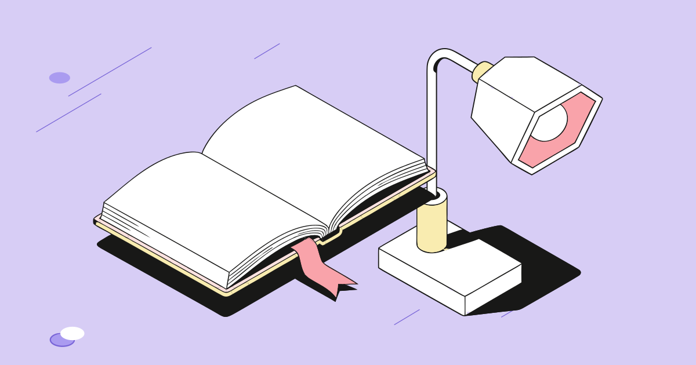
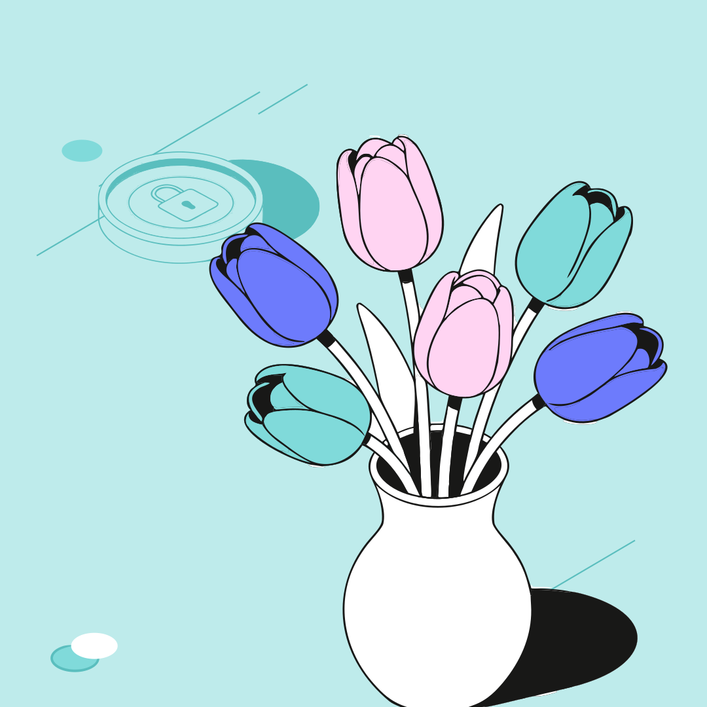
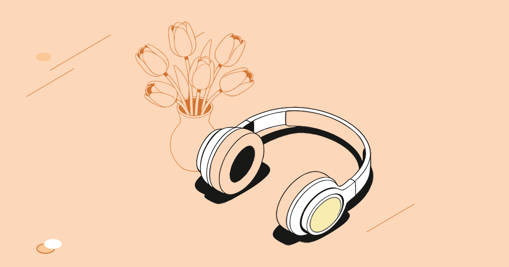

# Сборщик иллюстраций из библиотеки компонентов

Веб-сервис собирает векторные композиции из готовых объектов библиотеки. Новых объектов он не создаёт: итог — копии исходных SVG из Figma, расставленные и перекрашенные в рамках цветовой схемы.

- **Сервис:** https://composer-nu-seven.vercel.app
- **Репозиторий:** https://github.com/cartem2005-max/composer
- **Примеры:** [`examples/`](examples/) — собраны тем же кодом, объекты подобрал ИИ по метафоре.

| «Учиться по вечерам после работы» → книга, лампа · 1200×630, «Собранно» |
|---|
|  |

| «Весенняя распродажа цветов» → тюльпаны, фоновая монета · квадрат, «Со смещением» | «Отпуск без телефона» → наушники, фоновые тюльпаны · 1200×630 |
|---|---|
|  |  |

## Что умеет

- **По метафоре или заголовку** объекты подбирает ИИ (Claude Haiku), раскладывает их код. Понимает отрицания: в «Отпуск без телефона» телефона не будет. Если ИИ недоступен, работает словарь ключевых слов.
- **По списку названий** разбирает код, без ИИ: опечатки, падежи, «фоновые тюльпаны», «без лампы», эмодзи.
- **Редактор:** добавить, перетащить, повернуть, дублировать, удалить, порядок слоёв, отмена. Объект можно сделать главным или фоновым и сменить его цвета в рамках схемы.
- **Форматы:** 1200×630, квадрат, вертикаль; раскладки «Собранно», «Со смещением», «Под заголовок»; кнопка «Другой вариант».
- **Цвет:** 3 схемы из макета и своя палитра (6 или 8 HEX) — перекрашивается вся композиция сразу.
- **Результат:** «Копировать для Figma» (Ctrl+V — векторы со слоями), SVG, все форматы в zip, PNG-превью, ссылка «Поделиться».

## Как устроено

- **Хранение.** При сборке скрипт разбирает выгрузку Figma на 10 объектов (L и S, главный и фоновый) и заменяет каждый цвет ролью: `#F9ECB0` → `{obj1}`, `#7864D7` → `{bg3}`. Геометрия объектов не меняется. Цвет не из схемы — сборка падает с ошибкой.
- **Переиспользование.** Объект на холсте — ссылка на элемент библиотеки плюс положение, поворот и тон. Копия объекта копирует только эти поля, разметка одна.
- **Перекраска.** При отрисовке роли заменяются цветами выбранной схемы, поэтому смена схемы или палитры перекрашивает всё сразу и выйти за схему нельзя. Масштаб общий — пропорции между объектами сохраняются.
- **Подбор.** ИИ получает каталог из 10 объектов и может вернуть только их `id` — ограничение стоит в коде, а не в промпте. Отрицаемые объекты код убирает заранее. Ключ API хранится на сервере.
- **Стоимость:** около $0,25 за 1 000 подборов по метафоре; всё остальное работает без ИИ.

Подробно: [описание/архитектура.md](описание/архитектура.md).

## Как проверено

- **Правила задания** — на 2 000 случайных композиций: цвета только из схемы, геометрия объектов совпадает с Figma, пропорции сохранены.
- **Подбор ИИ** — 751 метафора и 224 попытки сломать подбор. На фразах, которых модель не видела при настройке, 85–91 % совпадений с эталоном (словарь без ИИ — 46–72 %). Ни одного объекта вне библиотеки, ни одна атака не сработала.
- **Списки названий** — 225 из 225, **палитры** — 61 из 61.
- **Интерфейс** — 140 сценариев в браузере, включая телефон.

Подробно: [описание/тестирование.md](описание/тестирование.md).

## ИИ-инструменты

- **Claude Code** — основная разработка.
- **ChatGPT (GPT-6.1 Sol)** — генерация тестовых наборов: метафоры, атаки, списки компонентов, палитры, сценарии интерфейса.
- **Claude Haiku 5.5** — внутри сервиса: подбор объектов по метафоре.

## Запуск

```bash
npm install
npm run dev          # ИИ работает, если есть .env.local с ANTHROPIC_API_KEY
npm test             # автотесты правил, ссылки и прогон фраз через словарь
npm run e2e          # тесты интерфейса в браузере
npm run build        # сборка библиотеки, проверка типов, сборка сайта
```
